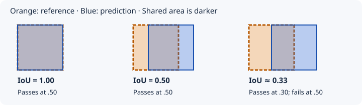

# Understanding detection results

Use this guide for Find box metrics and result states. [Find design](find-objects-design.md) explains the algorithms; [V6 controls](find-objects-v6.md) explains user settings.

Count needs count labels, Search needs query/photo relevance labels, and HTML needs defect labels. Box scores cannot validate those separate tasks.

## Three different kinds of number

| Kind | Examples | Meaning |
|---|---|---|
| Measurement | Precision, recall, F1 | Outcomes against reference labels |
| Evaluation rule | IoU .50/.30 | Required overlap for a match |
| Detection control | Confidence gates, identity gates, budgets | Rules that affect the search |

Model confidence is not measured accuracy. Two settings can both be .50 while controlling different things.

## IoU: how well do the boxes overlap?

**Intersection over union:**

`IoU = shared box area / area covered by either box`

The overlap is counted once in the denominator. IoU 1 means identical boxes; 0 means no overlap. IoU .50 means the intersection is half the union, not necessarily half the reference box.

At evaluation IoU .50, a prediction needs at least .50 overlap with a reference to match. At .30, a box with IoU .40 also matches. Lowering this threshold changes scoring, not returned boxes.

Duplicate suppression instead compares **two predicted boxes**. Its overlap threshold can change which boxes remain. This is separate from prediction-to-reference evaluation IoU.

## Precision and recall: correct predictions versus objects found

- **True positive (TP):** a prediction matched to a reference at the stated IoU.
- **False positive (FP):** an unmatched prediction, including extra duplicates or predictions on negative images.
- **False negative (FN):** an unmatched reference object.

Each reference matches at most one prediction. The scorer uses maximum-cardinality one-to-one matching. A poorly placed box can cause both an FP and an FN.

### Illustrative example

This is an example, not a benchmark result. Suppose 20 dogs are labeled, 10 boxes are returned, and eight match different dogs at IoU .50:

| Quantity | Calculation | Result |
|---|---|---|
| TP / FP / FN | 8 matches / 2 unmatched predictions / 12 unmatched dogs | 8 / 2 / 12 |
| Precision | `TP / (TP + FP)` = 8 / 10 | 80% |
| Recall | `TP / (TP + FN)` = 8 / 20 | 40% |
| F1 | `2 × TP / (2 × TP + FP + FN)` | 53.3% |

Report both precision and recall. The scorer uses zero for a zero denominator, so include TP/FP/FN and negative-image results to explain that convention.

Dataset **micro** scores sum TP/FP/FN before calculating ratios; they are not averages of per-image percentages. These fixed-IoU metrics are not COCO AP/mAP.

## Confidence and verification probability

| Signal | What it means |
|---|---|
| Box confidence | Confidence in the box answer; not the fraction meeting evaluation IoU |
| Choice confidence | Concentration among alternatives; distinct from `P(none)` or `P(same)` |
| Noul probability | Estimated probability of the stated yes/no condition; no separate confidence field |
| Calibration | Whether those signals predict independently labeled outcomes in the intended task |

Presence, complete extent, and identity are different questions. High confidence or repeated agreement does not establish correctness.

In V4/V6, raising the **box-check trigger** checks more boxes. Raising **verification acceptance** can reject more checked boxes and cause subdivision. Measure the complete search after either change.

### Presence and count uncertainty

For an illustrative Choice distribution `none=0, one=.48, two=.35, three_or_more=.17`, presence has probability 1 while the exact count is uncertain. V5 uses `1 − P(none)` for discovery, then a separate crop-presence check. Requiring one positive count alternative to exceed .50 would discard this evidence. These are still model estimates.

## What result states mean

| State | Interpretation |
|---|---|
| Located box | Displayed individual prediction; V5 may still require extent review |
| Confirmed by checks | V5 presence/edge checks passed; not independent truth |
| Extent review | V5 has not established complete visible extent; the box remains displayed |
| Additional/provisional observation | Evidence not accepted as another resolved individual |
| Unresolved identity group | Same/different-instance relationships remain uncertain; not an object count |
| Cluster reference | V4/V6 group-navigation aid, excluded from individual totals |
| Minimum coverage complete | Scheduled minimum tiles processed; not proof every object was found |
| Unresolved work | Remaining/limited search or uncertain checks; not a measured missed-object count |

V5 benchmarks report all returned `boxes`, including extent-review outputs, and the confirmed-only subset as `confirmedIou50`. Always name the prediction set. Changing display visibility must not change the scored underlying boxes.

## What users can change

Choose dataset/photo, target, mode, and V1–V6 strategy. Locate all with V6 is initially selected. Only V6 exposes numeric overrides; see [Advanced settings](find-objects-v6.md#advanced-settings). Service `.env` settings do not control these gates.

Normal photos have no reference boxes, so the app cannot calculate measured precision/recall for them.

## Reading a benchmark without changing its meaning

Check the IoU standard, prediction set, label/extent policy, exclusions, source-group counts, model/configuration hashes, metrics, uncertainty, failures, usage, and timing. Body-only and full-instance references are different contracts.

Three repeats of one photo are not three independent sources. Reused development data is not untouched confirmation. Count and identity errors need appropriate audits beyond IoU matching.

Evaluation IoU can rescore saved predictions. Changes to prompts, gates, or crop policy can alter later requests and need fresh complete runs. Follow [evaluation practice](development.md#changing-detection-or-evaluation-settings); keep measured reports and evidence in ignored folders.
